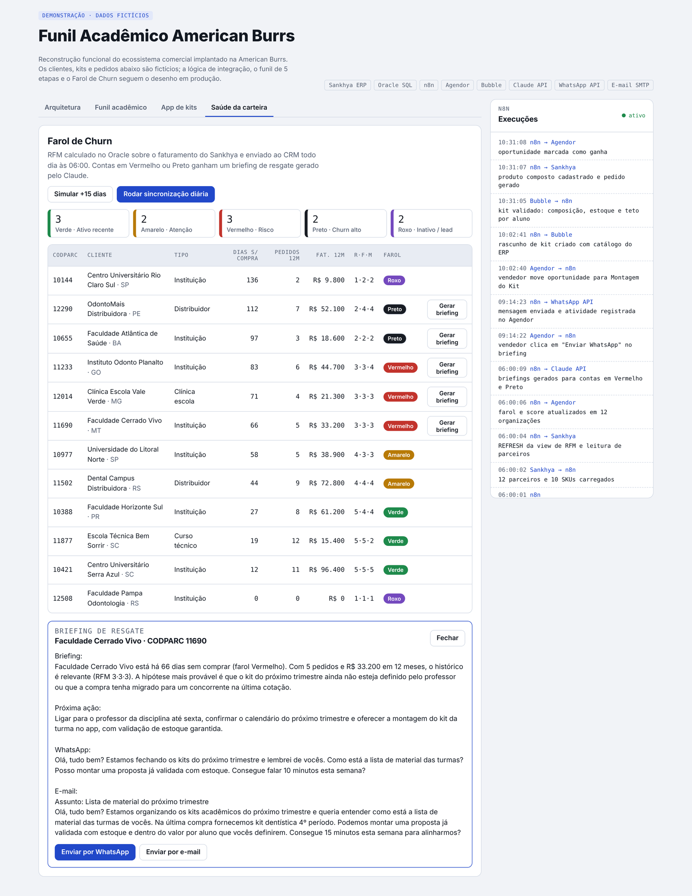

# Farol de Clientes + CRM de Kits

> **Reconstrução para portfólio.** O sistema original rodou em produção na American Burrs
> (indústria odontológica, vendas B2B para o meio acadêmico). Este repositório **não contém
> código, dados, credenciais nem informações de clientes** do ambiente real. Clientes, produtos,
> pedidos, telefones e e-mails são fictícios. O ERP (Sankhya sobre Oracle) é simulado.

Um produto que entrega ao vendedor a conta já lida, com a próxima ação e a mensagem prontas, no
dia em que o cliente começa a esfriar. O vendedor não abre painel, não preenche CRM e não monta
kit na planilha: revisa e envia.

Meu papel: AI Product Builder, com o produto de ponta a ponta, do discovery à adoção. A história
completa, em primeira pessoa, está em [docs/CASE.md](docs/CASE.md), e o PRD em [docs/PRD.md](docs/PRD.md).



## Resultado

- **Mais de 60% de redução de custo** com ferramentas comerciais. Uma das duas licenças (CRM)
  saiu, e a montagem de kit validou substituir também a outra (força de vendas), que era a mais cara.
- **O farol passou a orientar a rotina do vendedor**, depois de anos no ERP sem ninguém consultar.
- **O preenchimento manual acabou.** Cadastro e validação de kit passaram a ler o ERP.

## O problema

O ERP já classificava cada cliente por cor, conforme os dias desde a última compra. A informação
estava certa e ninguém a usava. O vendedor não gostava de preencher o CRM, e oportunidades de
recompra passavam sem que ele ou a diretoria percebessem.

A leitura óbvia seria adesão: treinar, cobrar, fazer um painel melhor. O diagnóstico foi outro.
O vendedor não precisava de mais informação, precisava de menos coisa para ler antes de agir.
O farol estava certo e mesmo assim cobrava uma atenção que ele não tinha.

## Para quem

| Pessoa | O que faz | O que precisa do produto |
|---|---|---|
| **Vendedor** | Atende instituições e professores, monta e cadastra kits | Saber com quem falar hoje e já ter o que dizer |
| **Professor** (quem decide) | Monta o kit de brocas da turma a cada trimestre de aulas | Ser procurado antes de fechar o próximo kit, sem pressão de desconto |
| **Gestão comercial** | Acompanha carteira e custo da operação | Ver resgate e recompra sem depender de relatório manual |

O cadastro no ERP pode estar no nome da faculdade ou do próprio professor. O produto segue o
cadastro que existe, e o custo dessa escolha está registrado em
[DECISOES.md](docs/DECISOES.md#a3-codparc-como-chave-de-integração).

## A hipótese e como foi validada

**Hipótese de maior risco:** o vendedor usaria a informação se ela chegasse pronta no lugar onde
ele já trabalha, em vez de exigir que ele fosse buscá-la.

**Teste:** antes de construir qualquer coisa própria, o fluxo rodou sobre uma plataforma de CRM
pronta (Agendor), escolhida para ganhar tempo, com as integrações construídas do zero em vez de
compradas. Só depois de ver o vendedor usando, CRM, funil e montagem de kit foram para uma
aplicação própria em low-code (Bubble).

## Como o produto evoluiu

| Fase | O que entrou | O que validou |
|---|---|---|
| Discovery | Lean Inception | O professor como decisor e o ciclo trimestral |
| MVP | Farol e briefing sobre um CRM de mercado, com integrações construídas do zero | Se o vendedor age sobre o briefing pronto |
| Produto próprio | CRM, funil e montagem de kit numa aplicação própria em low-code | Que dava para tirar a licença do CRM e substituir a de força de vendas |
| Reconstrução pública | Regras em código, testes e eval da IA, com dados fictícios | As regras do produto ficam testáveis e versionadas |

## Decisões de produto

| # | Decisão | Por quê |
|---|---|---|
| [P1](docs/DECISOES.md#p1-levar-o-dado-até-o-vendedor-em-vez-de-melhorar-o-painel) | Levar o dado até o vendedor em vez de melhorar o painel | O gargalo era atenção, não informação |
| [P2](docs/DECISOES.md#p2-disparar-no-vermelho-para-antecipar-e-no-preto-para-resgatar) | Disparar no vermelho para antecipar e no preto para resgatar | As faixas do farol acompanham o ciclo trimestral do professor |
| [P3](docs/DECISOES.md#p3-a-ia-redige-o-vendedor-decide) | A IA redige, o vendedor decide | Nenhum texto chega ao cliente sem alguém ler |
| [P4](docs/DECISOES.md#p4-as-regras-do-negócio-viram-regras-do-produto) | As regras do negócio viram regras do produto | Só números do ERP, nenhuma promessa de desconto |
| [P5](docs/DECISOES.md#p5-validar-em-plataforma-pronta-antes-de-construir) | Validar em plataforma pronta antes de construir | Testar a adoção antes de pagar o custo de construir |
| [P6](docs/DECISOES.md#p6-a-regra-do-kit-mora-no-produto-não-na-cabeça-do-vendedor) | A regra do kit mora no produto, não na cabeça do vendedor | A montagem de kit não tinha regra |

## O que ficou fora, de propósito

- **Envio automático.** A IA não manda nada sozinha. O ganho de velocidade não compensava o risco
  de uma mensagem errada para um professor.
- **Desconto ou condição comercial.** O vendedor não tinha essa autonomia, então o produto também não.
- **Score preditivo de churn.** A regra de dias sem compra já era entendida e aceita pelo comercial.
  Trocar por um modelo opaco teria custado a confiança que o farol precisava ganhar.
- **Tela dentro do ERP.** A experiência do vendedor ficaria presa ao ERP, que era justamente o problema.

## Como o produto se mede

| Métrica | O que responde | Status |
|---|---|---|
| Custo com ferramentas comerciais | O produto se paga? | **Medido em produção:** mais de 60% de redução |
| Contas no vermelho que recompram no trimestre seguinte | A antecipação funciona? (métrica principal) | A instrumentar |
| Tempo entre a conta entrar no vermelho e o primeiro contato | O vendedor age no dia certo? | A instrumentar |
| Briefings enviados sem edição | O texto da IA serve como está? | A instrumentar: o rascunho já existe, falta comparar com o enviado |
| Briefings que caíram no template | Com que frequência a IA falha? | **Implementado:** cada fallback gera evento com o motivo |
| Briefings com número inventado ou desconto | O guardrail se sustenta? | **Medido no eval:** rubrica automática em 20 contas |

A métrica principal é a recompra no trimestre seguinte porque é ela que liga o produto à receita.
As outras explicam por que ela sobe ou não.

## Roadmap

**Agora (neste repositório):** regra do farol, validação de kit, geração do briefing com retry e
fallback, eval com rubrica e histórico por versão de prompt.

**Próximo**
- Prompt v2 com tom diferente para antecipação (vermelho) e resgate (preto), comparado com o v1 no eval.
- Fila do dia ordenada por valor dos últimos 12 meses, para o vendedor saber por onde começar.
- Registro da diferença entre rascunho e texto enviado, para medir edição.

**Depois**
- ERP simulado em Postgres, orquestração no n8n, app de CRM e kits, mock do WhatsApp.
- Mensagem de WhatsApp como template aprovado, porque cliente inativo está fora da janela de 24 horas
  da API ([decisão A10](docs/DECISOES.md#a10-mock-do-whatsapp-com-o-contrato-da-cloud-api)).

## Tese

IA em operação comercial funciona melhor quando é invisível: o vendedor não conversa com um
chatbot, ele recebe o trabalho pronto no lugar onde já está. E as regras que o negócio impõe a ele
valem também para o modelo.

## A demonstração

Uma versão navegável do produto, com dados fictícios, está em
[docs/demo/funil.html](docs/demo/funil.html): baixe o arquivo e abra no navegador. Ela mostra a
arquitetura, o funil de 5 etapas, a validação de kit e o farol com o briefing.

| Validação do kit por turma | Como as peças conversam |
|---|---|
|  |  |


## O que este repositório mostra

A reconstrução troca o Bubble por código, para que as regras fiquem testáveis e versionadas.

| Parte | Onde está | Status |
|---|---|---|
| Regra do farol, fiel ao SQL de produção | `src/domain/farol.ts` | implementado |
| Validação do kit por turma (mínimo de unidades, tipos de broca, estoque, teto de custo) | `src/domain/kit.ts` | implementado |
| Geração do briefing com retry, timeout e fallback determinístico | `src/domain/briefing/` | implementado |
| Adaptador da Claude API com saída estruturada | `src/infra/anthropic.ts` | implementado |
| Eval com rubrica automática e histórico por versão de prompt | `scripts/`, `evals/` | implementado |
| ERP simulado em Postgres, app Next.js, workflows n8n, mock do WhatsApp | | fase 2 |

Construído com um agente de código. Cada desvio dele do plano aprovado está registrado em
[docs/LOG_DE_ERROS.md](docs/LOG_DE_ERROS.md), com a regra que passou a valer depois.

## Como rodar

Requer Node 22 ou superior. Nenhuma chave é necessária para os três primeiros comandos.

```bash
npm install
npm test                      # 72 testes: farol, kit, schema, fallback e rubrica
npm run eval -- --mock        # 20 contas, cliente que segue as regras: aprovação de 100%
npm run eval -- --mock=ruim   # mesmo eval com um cliente defeituoso: a rubrica reprova metade
```

Com `ANTHROPIC_API_KEY` no `.env`, `npm run eval` roda contra a Claude API real, e
`npm run eval:compare` compara as duas execuções mais recentes, critério a critério.

## Avaliação do briefing

As 20 contas fictícias ficam em `evals/fixtures/contas.json`. A rubrica
(`src/domain/briefing/rubrica.ts`) verifica:

- o formato da saída;
- se todos os números estão nos dados de entrada;
- se o briefing cita os dias sem compra e o último pedido;
- os limites de palavras do WhatsApp e do e-mail;
- se o WhatsApp termina com uma única pergunta;
- se não há promessa de desconto.

Cada execução grava `evals/runs/<data>_<prompt>_<modelo>.json` e `.md` e acrescenta uma linha em
`evals/historico.csv` com a versão e o hash do prompt, para comparar versões.

## Documentação

- [docs/CASE.md](docs/CASE.md): a história do produto, em primeira pessoa
- [docs/PRD.md](docs/PRD.md): problema, usuários, requisitos, métricas, fases e riscos
- [docs/DECISOES.md](docs/DECISOES.md): decisões de produto e de arquitetura, com alternativas e custo assumido
- [docs/LOG_DE_ERROS.md](docs/LOG_DE_ERROS.md): como supervisionei o agente de código
