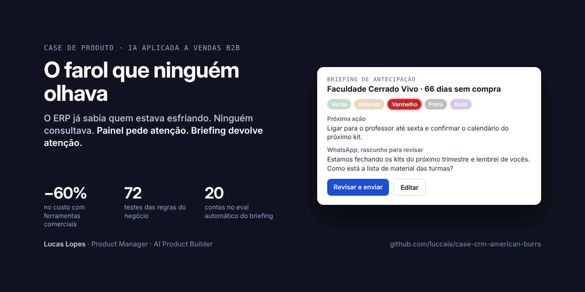
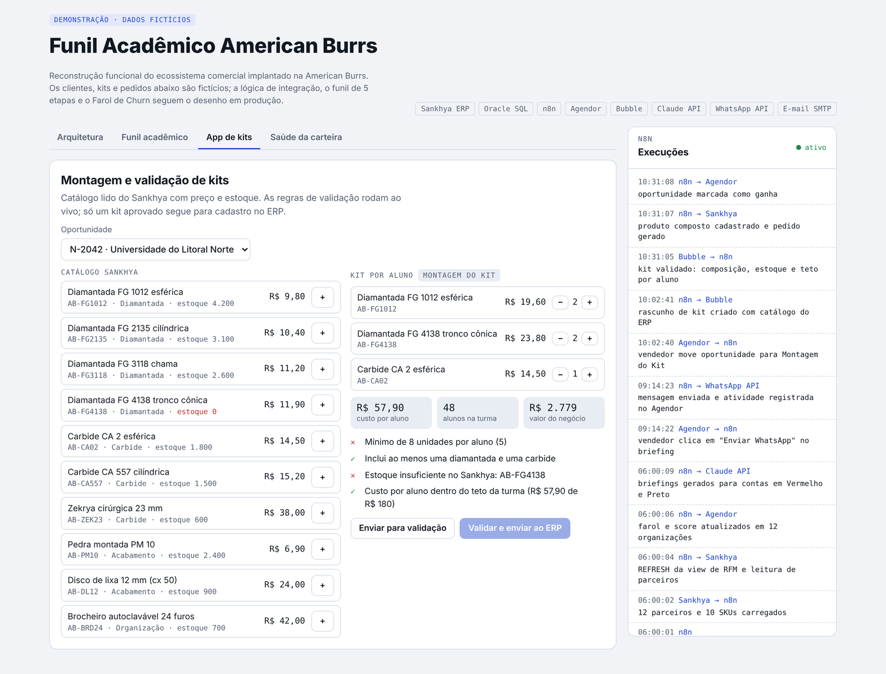
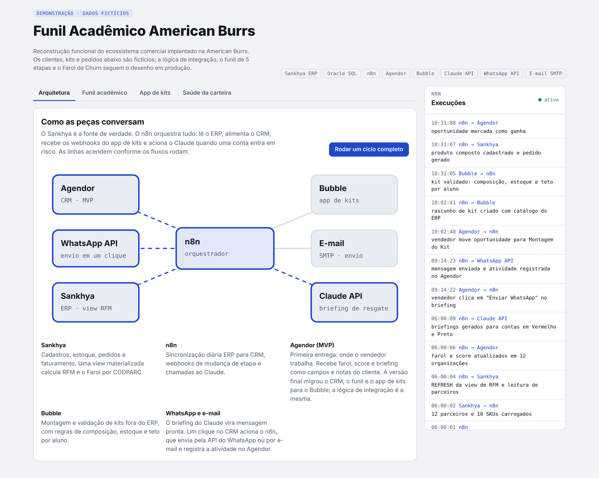
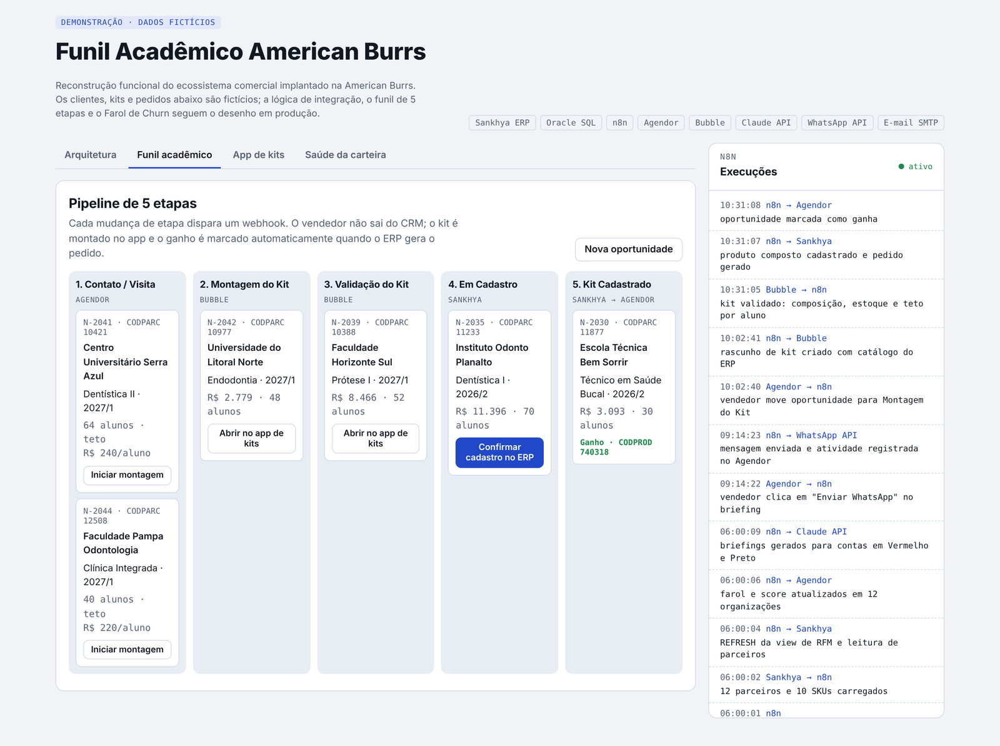

# Customer Loyalty and Retention: Traffic Light + Kit CRM



> **Portfolio reconstruction.** The original system ran in production at American Burrs (dental
> burs manufacturer, B2B sales to dental schools). This repository **contains no code, data,
> credentials or customer information** from the real environment. Customers, products, orders,
> phone numbers and emails are fictional. The ERP (Sankhya on Oracle) is simulated.

A customer loyalty product for B2B sales in dental education. The company's market strategy was to
build loyalty with the dentist from university onward, and the account that carries it is the
professor, who builds the class kit every academic term.

The product keeps that account buying, term after term. It hands the sales rep an account that has
already been read, with the next action and the message ready, on the day the customer starts to
cool down. The rep doesn't open a dashboard, doesn't fill in the CRM and doesn't build kits in a
spreadsheet: they review and send.

My role: AI Product Builder and Product Manager, owning the product end to end, from discovery to
rollout and adoption. The full story, in first person, is in [docs/CASE.md](docs/CASE.md), and the
PRD in [docs/PRD.md](docs/PRD.md).


## Outcome

- **80% reduction in commercial tool costs at full rollout**, after over 60% at the MVP stage. One
  of the two licenses (CRM) was dropped first, and the kit builder validated replacing the other one
  too (sales force automation), which was the more expensive of the two.
- **Adopted by the sales executives, and used day to day.** The product started in a Lean
  Inception across four business areas, with the field team at the table, and was built and
  validated with that team around their own pains: filling in the CRM by hand, repetitive funnel
  steps, and analyzing accounts in the ERP while on the road.
- **The traffic light started to drive the rep's routine**, after years sitting in the ERP with
  nobody checking it.
- **Manual data entry ended.** Kit registration and validation now read straight from the ERP.

## The problem

The ERP already segmented every customer by color, based on days since the last purchase (recency,
the R of RFM). The information was right and nobody used it. Reps didn't like filling in the CRM,
and repurchase opportunities slipped by without the rep or the leadership noticing.

The obvious reading was adoption: train, enforce, build a better dashboard. The diagnosis was
different. The rep didn't need more information, they needed less to read before acting. The
traffic light was right and still demanded attention the rep didn't have.

## Who it is for

| Person | What they do | What they need from the product |
|---|---|---|
| **Sales rep** | Serves schools and professors, builds and registers kits | Know who to talk to today and already have something to say |
| **Professor** (decision maker) | Builds the class's bur kit every academic term | Be contacted before closing the next kit, without discount pressure |
| **Sales leadership** | Tracks the portfolio and the cost of the operation | See win-back and repurchase without manual reports |

The ERP record can be under the school's name or the professor's own name. The product follows the
record that exists, and the cost of that choice is recorded in
[DECISIONS.md](docs/DECISIONS.md#a3-codparc-as-the-integration-key).

## The hypothesis and how it was validated

**Riskiest hypothesis:** reps would use the information if it arrived ready, in the place where they
already work, instead of requiring them to go and fetch it.

**Test:** before building anything of our own, the flow ran on an off-the-shelf CRM (Agendor),
chosen to save time, with integrations built from scratch instead of bought. Only after seeing reps
use it did the CRM, pipeline and kit builder move to our own low-code application (Bubble).

## How the product evolved

| Phase | What shipped | What it validated |
|---|---|---|
| Discovery | Lean Inception across four business areas, with the field team | The professor as decision maker and the term-based buying cycle |
| MVP | Traffic light and briefing on top of a market CRM, with integrations built from scratch | Whether reps act on a ready-made briefing |
| Own product | CRM, pipeline and kit builder in our own low-code application | That the CRM license could be dropped and the sales force tool replaced |
| Public reconstruction | Rules in code, tests and AI evals, with fictional data | That the product rules are testable and versioned |

## Product decisions

| # | Decision | Why |
|---|---|---|
| [P1](docs/DECISIONS.md#p1-bring-the-data-to-the-rep-instead-of-improving-the-dashboard) | Bring the data to the rep instead of improving the dashboard | The bottleneck was attention, not information |
| [P2](docs/DECISIONS.md#p2-trigger-on-red-to-anticipate-and-on-black-to-win-back) | Trigger on red to anticipate and on black to win back | The color bands follow the professor's academic term |
| [P3](docs/DECISIONS.md#p3-the-ai-drafts-the-rep-decides) | The AI drafts, the rep decides | No text reaches a customer without someone reading it |
| [P4](docs/DECISIONS.md#p4-business-rules-become-product-rules) | Business rules become product rules | ERP numbers only, no discount promises |
| [P5](docs/DECISIONS.md#p5-validate-on-an-existing-platform-before-building) | Validate on an existing platform before building | Test adoption before paying the cost of building |
| [P6](docs/DECISIONS.md#p6-the-kit-rule-lives-in-the-product-not-in-the-reps-head) | The kit rule lives in the product, not in the rep's head | Kit building had no rule |

## What was left out, on purpose

- **Automatic sending.** The AI sends nothing on its own. The speed gain didn't outweigh the risk
  of a wrong message reaching a professor.
- **Discounts or commercial terms.** Reps didn't have that authority, so the product doesn't either.
- **Predictive churn score.** The days-since-last-purchase rule was already understood and accepted
  by sales. Replacing it with an opaque model would have cost the trust the traffic light needed to
  earn.
- **Screens inside the ERP.** The rep's experience would stay trapped in the ERP, which was the
  problem in the first place.

## How the product is measured

| Metric | Question it answers | Status |
|---|---|---|
| Commercial tool costs | Does the product pay for itself? | **Measured in production:** over 60% at the MVP stage, 80% at full rollout |
| Red accounts that repurchase in the following term | Does anticipation work? (north star) | To be instrumented |
| Time between an account turning red and first contact | Does the rep act on the right day? | To be instrumented |
| Briefings sent without edits | Does the AI text work as is? | To be instrumented: the draft exists, the comparison with the sent text is missing |
| Briefings that fell back to the template | How often does the AI fail? | **Implemented:** every fallback emits an event with the reason |
| Briefings with invented numbers or discounts | Does the guardrail hold? | **Measured in evals:** automated rubric over 20 accounts |

Repurchase in the following term is the north star because it ties the product to revenue. The
others explain why it moves or doesn't.

## Roadmap

The full version, by capability and with each sprint's status, is in
[docs/product/roadmap.md](docs/product/roadmap.md).

**Now (in this repository):** traffic light rule, kit validation, briefing generation with retry
and fallback, evals with a rubric and history per prompt version.

**Next**
- Prompt v2 with a different tone for anticipation (red) and win-back (black), compared with v1 in
  the evals.
- Daily queue ranked by revenue over the last 12 months (the M of RFM), so the rep knows where to
  start.
- Recording the difference between the draft and the sent text, to measure edits.

**Later**
- ERP simulated in Postgres, orchestration in n8n, CRM and kit app, WhatsApp mock.
- WhatsApp message as an approved template, because inactive customers fall outside the API's
  24-hour window ([decision A10](docs/DECISIONS.md#a10-whatsapp-mock-with-the-cloud-api-contract)).

## Thesis

AI in sales operations works best when it is invisible: the rep doesn't chat with a bot, they
receive the work done in the place where they already are. And the rules the business imposes on
the rep apply to the model too.

## The demo

A clickable version of the product, with fictional data, is in
[docs/demo/funil.html](docs/demo/funil.html): download the file and open it in a browser. It shows
the architecture, the 5-stage pipeline, kit validation and the traffic light with the briefing. The
demo and the screenshots keep the original Portuguese interface used by the Brazilian sales team.

| Kit validation per class | How the pieces connect |
|---|---|
|  |  |



## What this repository shows

The reconstruction swaps Bubble for code, so the rules become testable and versioned.

| Part | Where | Status |
|---|---|---|
| Traffic light rule, faithful to the production SQL | `src/domain/farol.ts` | implemented |
| Kit validation per class (minimum units, bur types, stock, cost ceiling) | `src/domain/kit.ts` | implemented |
| Briefing generation with retry, timeout and deterministic fallback | `src/domain/briefing/` | implemented |
| Claude API adapter with structured output | `src/infra/anthropic.ts` | implemented |
| Retrieval over the account history (RAG), as used in production | | not rebuilt: the account data goes straight into the prompt |
| Evals with an automated rubric and history per prompt version | `scripts/`, `evals/` | implemented |
| ERP simulated in Postgres, Next.js app, n8n workflows, WhatsApp mock | | phase 2 |

In production, the briefing workflow used RAG over the account history to ground the text. The
reconstruction keeps the same grounding rule in a simpler form: the account data from the ERP goes
directly into the prompt, and the eval checks that every number in the output exists in that input.

Code identifiers and the generated briefing stay in Portuguese, because the product serves a
Brazilian sales team and Brazilian customers. The [glossary](docs/vision/glossary.md) maps each
term.

Built with a coding agent. Every deviation from the approved plan is recorded in
[docs/AGENT_LOG.md](docs/AGENT_LOG.md), with the rule that applied from then on.

## How to run

Requires Node 22 or later. No API key is needed for the first three commands.

```bash
npm install
npm test                      # 72 tests: traffic light, kit, schema, fallback and rubric
npm run eval -- --mock        # 20 accounts, client that follows the rules: 100% pass rate
npm run eval -- --mock=ruim   # same eval with a faulty client: the rubric fails half of them
```

With `ANTHROPIC_API_KEY` in `.env`, `npm run eval` runs against the real Claude API, and
`npm run eval:compare` compares the two most recent runs, criterion by criterion.

## Briefing evals

The 20 fictional accounts live in `evals/fixtures/contas.json`. The rubric
(`src/domain/briefing/rubrica.ts`) checks:

- the output format;
- whether every number appears in the input data;
- whether the briefing mentions days without purchase and the last order;
- the word limits for WhatsApp and email;
- whether the WhatsApp message ends with a single question;
- that there is no discount promise.

Each run writes `evals/runs/<date>_<prompt>_<model>.json` and `.md` and appends a line to
`evals/historico.csv` with the prompt version and hash, so versions can be compared.

## Documentation

**The product**
- [docs/CASE.md](docs/CASE.md): the product story, in first person
- [docs/PRD.md](docs/PRD.md): problem, users, requirements, metrics, phases and risks
- [docs/product/roadmap.md](docs/product/roadmap.md): roadmap by capability, with status and sprint

**How I think**
- [docs/vision/vision.md](docs/vision/vision.md): mission, problem and where the product is going
- [docs/vision/manifesto.md](docs/vision/manifesto.md): what I believe about AI in operations
- [docs/vision/principles.md](docs/vision/principles.md): the rules that break ties between decisions
- [docs/vision/glossary.md](docs/vision/glossary.md): the domain terms

**How I decide and learn**
- [docs/DECISIONS.md](docs/DECISIONS.md): product and architecture decisions, with alternatives and accepted cost
- [docs/sprints/](docs/sprints/README.md): review, retrospective and learning for each sprint
- [docs/AGENT_LOG.md](docs/AGENT_LOG.md): how I supervised the coding agent

## Contributing

You don't need to write code to contribute. See [how to contribute](docs/contributing/contributing.md),
the [Code of Conduct](CODE_OF_CONDUCT.md) and the [Security Policy](SECURITY.md).

## License

[MIT](LICENSE).
